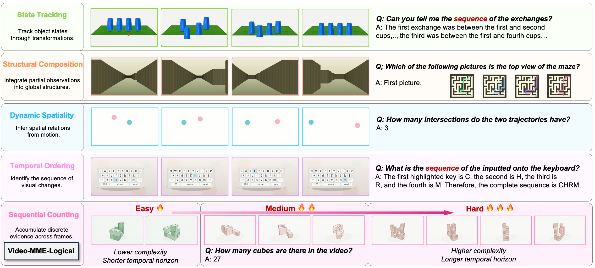
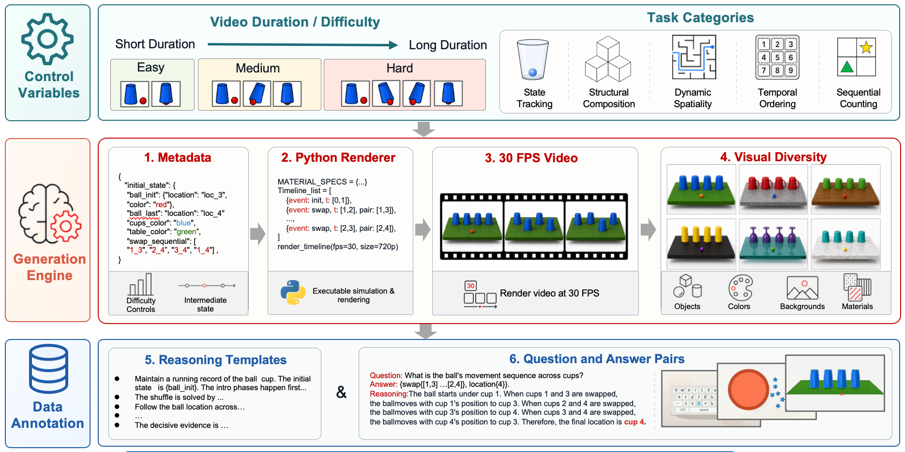

# Video-MME-Logical

**Video-MME-Logical: A Controlled Diagnostic Benchmark for Video Temporal-Logical Reasoning**

> 🎉 Accepted to Findings of EMNLP 2026.

This is the official repository for Video-MME-Logical, with the project page, evaluation code, and dataset download links. Both the evaluation benchmark and the 500K training dataset are publicly available on Hugging Face.

## Links

[🍎 Project Page](https://mrakas.github.io/video-mme-logical/) [📖 Paper](https://arxiv.org/pdf/2606.27828) [🤗 HF Paper](https://huggingface.co/papers/2606.27828) [🏆 Leaderboard](#-leaderboard) [📊 Evaluation Data](https://huggingface.co/datasets/marcuskwan/video-mme-logical) [🤗 Training Data (500K)](https://huggingface.co/datasets/marcuskwan/video-mme-logical-500k) [🤖 Reproduction Agent Guide](doc_agent.md)

## 🌟 News

- **[2026-10-12]** The [375-sample Mini Set](#mini-set-375-samples) and its GPT 6.1 Sol / Medium baseline (**82.7%**) are available for quick evaluation.
- **[2026-09-12]** Our [500K training dataset](https://huggingface.co/datasets/marcuskwan/video-mme-logical-500k) for video temporal-logical reasoning is now publicly available on Hugging Face!
- **[2026-08]** Video-MME-Logical is used to evaluate temporal-logical reasoning in [OpenMOSS’s MOSS-VL technical report](https://arxiv.org/abs/2608.15045), which reports scores of **17.1% for MOSS-VL-Instruct** and **10.8% for Gemma-4-12B-IT** on our benchmark.

## Mini Set (375 samples)

We provide a fixed **10% subset** for quick evaluation: **5 samples from each of 25 tasks at each of 3 difficulty levels**, giving **125 easy, 125 medium, and 125 hard samples**. Sampling is without replacement with seed `20261012`; original questions, answers, videos, and reference images are unchanged. The subset includes 255 direct-answer samples and 120 intermediate-state samples across 8 diagnostic tasks.

[Download videos + annotations (~352 MB)](https://huggingface.co/datasets/marcuskwan/video-mme-logical/resolve/main/video_mme_logical_mini.zip) · [Sample manifest](mini/mini_test_375.json) · [Sampling metadata](mini/sampling.json) · [Hugging Face dataset](https://huggingface.co/datasets/marcuskwan/video-mme-logical)

### Mini Set baseline

Evaluated on 2026-10-12 using **GPT 6.1 Sol / Medium** (`gpt-6.1-sol`) through independent `codex exec` calls. Each request receives the original question, all video frames sampled at **2 FPS**, and the required reference images. Tools and web search are disabled; ground-truth answers are used only for scoring. We use the repository's unchanged exact-match scorer.

| Evaluation subset | Overall | Easy | Medium | Hard |
|---|---:|---:|---:|---:|
| Final-answer tasks (Video-MME-Logical Mini, 255 samples) | **91.0% (232/255)** | 91.8% (78/85) | 90.6% (77/85) | 90.6% (77/85) |
| Intermediate-state tasks (Video-MME-Logical-S Mini, 120 samples) | **65.0% (78/120)** | 67.5% (27/40) | 60.0% (24/40) | 67.5% (27/40) |

The combined score across both subsets is 82.7% (310/375); this aggregate is provided only as a reference. Intermediate-state tasks use the original exact-match scorer for the complete annotated state sequence, without partial credit.

Direct-answer accuracy is **91.0% (232/255)**; intermediate-state accuracy is **65.0% (78/120)**. All 375 requests produced scored responses. These are Mini Set results; each task–difficulty cell has only 5 samples, so they should be interpreted separately from the full-benchmark leaderboard below.

[Per-task scores](results/mini_gpt_6_1_sol_medium/task_scores.csv) · [Summary](results/mini_gpt_6_1_sol_medium/summary.json) · [Heatmap](results/mini_gpt_6_1_sol_medium/task_heatmap.png)

## 🏆 Leaderboard

Scores are accuracy (%). The first two tables report results from our paper, omit our trained/SFT models, and show the compact overall difficulty breakdown. Additional results reported by other teams are listed separately below.

### Video-MME-Logical

| Model | Overall | Easy | Medium | Hard |
|---|---:|---:|---:|---:|
| Human Level | 95.9 | 98.4 | 95.9 | 93.4 |
| **Open-source Instruct Models** |  |  |  |  |
| Qwen3-VL-8B-Instruct | 11.9 | 13.4 | 12.8 | 9.6 |
| Qwen3-VL-30B-A3B-Instruct | 11.8 | 14.5 | 12.4 | 8.7 |
| Qwen3-Omni-30B-A3B-Instruct | 5.8 | 6.3 | 6.1 | 4.9 |
| Qwen2.5-VL-3B-Instruct | 1.9 | 3.1 | 1.5 | 1.3 |
| Qwen2.5-VL-7B-Instruct | 7.4 | 10.3 | 7.7 | 4.3 |
| Qwen2.5-VL-72B-Instruct | 12.5 | 15.2 | 13.1 | 9.1 |
| InternVL3.5-8B-Instruct | 12.1 | 13.8 | 13.5 | 8.9 |
| InternVL3.5-30B-A3B-Instruct | 8.7 | 9.5 | 9.7 | 7.0 |
| LLaVA-Video-7B-Qwen2 | 0.0 | 0.1 | 0.0 | 0.0 |
| LLaVA-Video-72B-Qwen2 | 2.4 | 4.7 | 1.9 | 0.7 |
| KimiVL-16B-A3B-Instruct | 2.9 | 5.4 | 2.2 | 0.9 |
| **Open-source Thinking Models** |  |  |  |  |
| Qwen3-VL-8B-Think | 6.6 | 7.9 | 5.8 | 6.0 |
| Qwen3-VL-30B-A3B-Think | 10.3 | 16.0 | 8.7 | 6.1 |
| Qwen3-Omni-30B-A3B-Think | 6.2 | 6.6 | 5.2 | 6.8 |
| KimiVL-16B-A3B-Think | 7.6 | 10.2 | 6.8 | 5.8 |
| **Proprietary Models** |  |  |  |  |
| GPT-5.4 | 22.7 | 31.7 | 20.3 | 16.1 |
| Gemini-3.1 Pro | **28.6** | **33.1** | **24.1** | **20.6** |

### Video-MME-Logical-S

| Model | Overall | Easy | Medium | Hard |
|---|---:|---:|---:|---:|
| Human Level | 96.1 | 98.5 | 96.0 | 93.8 |
| **Open-source Instruct Models** |  |  |  |  |
| Qwen3-VL-8B-Instruct | 0.0 | 0.0 | 0.0 | 0.0 |
| Qwen3-VL-30B-A3B-Instruct | 0.1 | 0.3 | 0.0 | 0.0 |
| Qwen3-Omni-30B-A3B-Instruct | 0.0 | 0.0 | 0.0 | 0.0 |
| Qwen2.5-VL-3B-Instruct | 0.0 | 0.0 | 0.0 | 0.0 |
| Qwen2.5-VL-7B-Instruct | 0.1 | 0.2 | 0.0 | 0.0 |
| Qwen2.5-VL-72B-Instruct | 0.1 | 0.2 | 0.0 | 0.0 |
| InternVL3.5-8B-Instruct | 0.0 | 0.0 | 0.0 | 0.0 |
| InternVL3.5-30B-A3B-Instruct | 0.1 | 0.3 | 0.0 | 0.0 |
| LLaVA-Video-7B-Qwen2 | 0.1 | 0.2 | 0.0 | 0.0 |
| LLaVA-Video-72B-Qwen2 | 0.0 | 0.0 | 0.0 | 0.0 |
| KimiVL-16B-A3B-Instruct | 0.1 | 0.2 | 0.0 | 0.0 |
| **Open-source Thinking Models** |  |  |  |  |
| Qwen3-VL-8B-Think | 0.6 | 1.3 | 0.3 | 0.0 |
| Qwen3-VL-30B-A3B-Think | 3.6 | 9.0 | 1.3 | 0.3 |
| Qwen3-Omni-30B-A3B-Think | 1.2 | 1.7 | 1.3 | 0.7 |
| KimiVL-16B-A3B-Think | 0.0 | 0.0 | 0.0 | 0.0 |
| **Proprietary Models** |  |  |  |  |
| GPT-5.4 | **17.4** | **30.8** | **13.7** | **7.7** |
| Gemini-3.1 Pro | 10.8 | 18.7 | 8.5 | 5.2 |

### Results reported by other teams

The following results are for Video-MME-Logical.

| Model | Overall (%) | Source |
|---|---:|---|
| MOSS-VL-Instruct-0708 | 17.1 | [MOSS-VL report, Table 5](https://arxiv.org/html/2608.15045v1#S6) |
| Gemma-4-12B-IT | 10.8 | [MOSS-VL report, Table 5](https://arxiv.org/html/2608.15045v1#S6) |

Results reported by the OpenMOSS team; not independently reproduced by us. Evaluation settings may differ from those in our paper. Difficulty-level breakdowns and Video-MME-Logical-S results were not reported.

## Paper Figures

### Figure 1: Video-MME-Logical Overview



### Figure 2: Benchmark Construction Pipeline



## Release TODO

- ✅ [arXiv paper released](https://arxiv.org/abs/2606.27828)
- ✅ Accepted to Findings of EMNLP 2026
- ✅ [Video-MME-Logical benchmark released](https://huggingface.co/datasets/marcuskwan/video-mme-logical)
- ✅ [500K training dataset released](https://huggingface.co/datasets/marcuskwan/video-mme-logical-500k)
- ☐ Model checkpoint: coming soon

## Evaluation

For a Codex-friendly end-to-end workflow from Hugging Face dataset download to API evaluation, see [doc_agent.md](doc_agent.md).

```bash
pip install google-genai
export GEMINI_API_KEY=your_api_key
python eval.py --dataset path/to/eval_items.json
```

The script writes JSONL predictions and prints the final accuracy.

## Citation

If you find this project useful, please cite:

```bibtex
@article{kwan2026video,
  title={Video-MME-Logical: A Controlled Diagnostic Benchmark for Video Temporal-Logical Reasoning},
  author={Kwan, Hohin and Li, Hongyu and Zhang, Ray and Zhang, Manyuan and Kong, Xianghao and Rao, Anyi and Xie, Jiahao and Liu, Si},
  journal={arXiv preprint arXiv:2606.27828},
  year={2026}
}
```

## License

This repository is released under the MIT License. See [LICENSE](LICENSE).

## Contact

For questions about Video-MME-Logical, please contact the authors via WeChat.


